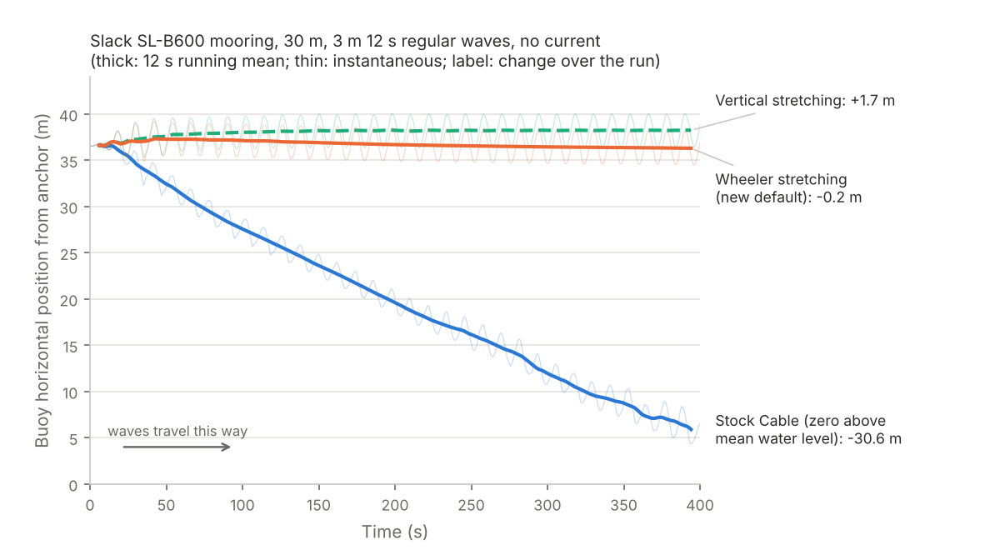

# Wave kinematic stretching

`patches/cable-wave-stretching.patch` changes how `cable-free` evaluates wave
particle velocities and accelerations near the sea surface. `scripts/build.sh`
applies it after `cable-free-surface-buoy.patch`. Stock `cable` is unchanged.

## Summary

Linear (Airy) wave theory gives the orbital velocity only up to the mean
water level. Stock Cable sets the wave velocity and acceleration to zero for
any point above it. A buoy riding the surface then sits above mean level on
every crest, where it feels no orbital flow, and below it in every trough,
where it feels the full backward flow. The drag no longer averages to zero
over a wave, and the buoy is pushed steadily **up-wave**.

In a slack mooring with little or no current this is easy to see: the buoy
walks up-wave through the run. In the demo case below it moves 31 m in
400 s. With a stronger current the push is hidden, but it still lowers the
mean and peak line tensions.

The patch replaces the zero-above-mean-level rule with **Wheeler stretching**
by default, which extends the kinematics up to the instantaneous surface.



## The methods

Notation follows Cable's internal coordinates: $x$ is height above the seabed,
$h$ the water depth, and $\eta(t, y)$ the surface elevation at the point's
horizontal position. Linear theory gives each wave component's kinematics as
a function of $x$ through $\cosh(kx)/\cosh(kh)$ and $\sinh(kx)/\cosh(kh)$,
valid for $0 \le x \le h$. Each method chooses the height $x_s$ at which to
evaluate those expressions.

| Method | `CABLE_STRETCHING` | Evaluation height | Above the instantaneous surface |
|---|---|---|---|
| Wheeler | `wheeler` (default) | $x_s = x\,h/(h + \eta)$ | zero (in air) |
| Vertical | `vertical` | $x_s = \min(x, h)$ | zero (in air) |
| None (stock Cable) | `none` | $x_s = x$ | zero above **mean** level |

**Wheeler stretching** maps the real water column, from the seabed to the
instantaneous surface at $h + \eta$, linearly onto the linear-theory column
from $0$ to $h$. The seabed stays at the seabed and the instantaneous surface
always maps to the mean surface, so a point on the surface gets the
linear-theory surface velocity on a crest and in a trough alike. The profile
is stretched upward under crests and compressed under troughs. Over a wave
cycle the velocities a surface-following body sees are symmetric, and
quadratic drag averages to zero. This is the usual choice in offshore codes
and is one of the three methods OrcaFlex offers.

**Vertical stretching** leaves the kinematics unchanged below the mean
water level and holds them at their mean-level values above it. In a trough
a body sits below mean level, where the velocity has decayed a little, but on
a crest it gets the full surface value. That leaves a small **down-wave**
bias. It happens to have the sign of real wave drift, but its size is an
accident of the approximation, not a model of Stokes drift.

**None** reproduces stock Cable exactly and is there for comparison with
earlier runs.

All three apply to accelerations as well as velocities: the linear
acceleration is evaluated at the same $x_s$. Regular waves, random seas from a
wave file and Cable's built-in spectrum, and both 2D and 3D runs are covered.
In 3D the elevation includes the z-direction wave components.

## Choosing the method

The method is read from the environment variable `CABLE_STRETCHING` once per
run. Leave it unset for Wheeler. `cable-free` writes the method it used to
its log, for example:

```
cable-free: wave kinematics with Wheeler stretching
```

From a terminal:

```bash
scripts/run_case.sh slb600_waves                          # Wheeler (default)
CABLE_STRETCHING=none scripts/run_case.sh slb600_waves    # stock Cable kinematics
CABLE_STRETCHING=vertical cable-free -in my_case.cbl -out my_case.cab -quiet
```

From the designer notebook, set it in a cell before running; the solver
inherits the notebook's environment:

```python
import os
os.environ["CABLE_STRETCHING"] = "none"     # or "wheeler", "vertical"; del it to go back to the default
```

Any other value stops the run with an error. The setting doesn't go in the
`.cbl`, so input files still run unchanged with stock `cable`.

## The change

Only `solver/waves.c` changes, by about 160 lines:

- `StretchHeight()` returns the evaluation height $x_s$ for a point, or
  reports that the point is out of the water. `WaveParticleVelocity()` and
  `WaveParticleAcceleration()` call it in place of the stock test
  `x > depth || x < 0`, then evaluate the unchanged linear expressions at
  $x_s$.
- `StretchElevation()` returns $\eta$ from the same components, amplitudes,
  phases and ramp as the kinematics: the y-direction set always, the
  z-direction set for 3D calls. It caches the last value, since velocity and
  acceleration are asked for at the same point and time in turn.
- In a random sea, Cable skips components whose wavelength is short compared
  with a point's depth. That test now uses the stretched height too.

`WaveSurfaceVelocity()` (for `wave-follower` forcing), `InputVelocity()`
(for `velocity` forcing), Froude-Krylov forcing and Stokes drift are
untouched. Nothing changes during `-auto`'s static relaxation, where Cable
switches the waves off.

## Verification

These are internal checks, not comparisons with observations or another code.

1. **Regression.** With `CABLE_STRETCHING=none`, `slb600_waves` and
   `slb600_jonswap` give byte-identical `.cab` output to `cable-free` built
   without this patch.

2. **Kinematics.** A small harness called the patched `WaveParticleVelocity()`
   for a point held 0.2 m below the instantaneous surface through one
   regular wave in 30 m of water. The table gives the horizontal velocity on
   the crest and in the trough, and the cycle mean of $v|v|$, expressed as the
   steady current that would give the same mean drag. The linear surface
   orbital speed is 1.00 m/s for H = 3 m, T = 12 s.

   | Method | Crest | Trough | Equivalent steady current |
   |---|---|---|---|
   | None (stock) | 0.00 m/s | −0.95 m/s | 0.48 m/s up-wave |
   | Vertical | +1.00 m/s | −0.95 m/s | 0.14 m/s down-wave |
   | Wheeler | +0.99 m/s | −0.99 m/s | 0.02 m/s |

   For H = 5 m, T = 15 s the stock rule is equivalent to a steady 0.75 m/s
   up-wave current, and Wheeler to 0.02 m/s.

3. **Drift in a slack mooring** (case `stretching_demo`, figure above).
   An SL-B600 on 66 m of chain and sinking polyester in 30 m, 3 m 12 s
   regular waves, current decaying from 0.05 m/s to zero. Change in the
   wave-averaged buoy position over 400 s: stock −30.6 m (still drifting
   up-wave at the end), Wheeler −0.2 m, vertical +1.7 m.

4. **Effect on current-dominated cases.** With 0.5 m/s current, after the
   first 30 s:

   | Case | Method | Buoy mean x | Buoy tension mean / max | Anchor tension mean / max |
   |---|---|---|---|---|
   | `slb600_waves` | none | 40.9 m | 130 / 328 N | 106 / 295 N |
   | `slb600_waves` | Wheeler | 41.6 m | 138 / 335 N | 112 / 300 N |
   | `slb600_jonswap` | none | 40.6 m | 118 / 667 N | 95 / 624 N |
   | `slb600_jonswap` | Wheeler | 41.3 m | 125 / 737 N | 100 / 701 N |

   The stock rule understates mean tensions by about 6% here and peak
   tensions by up to about 12%. Results from earlier `cable-free` runs in
   waves are likely to be low by similar amounts.

5. **Run time.** Unchanged for regular waves. About 25% longer for a random
   sea: `slb600_jonswap` took 53 s with `none` and 67 s with Wheeler.

## Limitations

1. **No second-order drift.** Linear kinematics have no Stokes drift, and
   Cable has no mean wave drift force. Both push a surface buoy slowly
   down-wave in reality. With Wheeler stretching a buoy in waves alone
   should hover about its mean position rather than drift down-wave.
2. **Crest kinematics.** Wheeler stretching slightly underestimates
   near-surface velocities under steep crests compared with nonlinear wave
   theories, and vertical stretching overestimates them. Neither models
   breaking waves.
3. **Evaluation point.** The kinematics on the free-floating buoy are still
   evaluated at its base node, as in `cable-free-surface-buoy.patch`, not
   averaged over its draft.
4. **Line nodes near the surface.** Line nodes above the mean water level are
   now inside a crest and feel its flow, where stock Cable gave them none.
   Their buoyancy and weight are unchanged and still use the mean surface.

## References

Journal details were cited from memory and should be checked before use in a
publication.

- Orcina. OrcaFlex help: Waves, kinematic stretching.
  https://www.orcina.com/webhelp/OrcaFlex/Content/html/Waves,Kinematicstretching.htm
- Wheeler, J. D. (1970). Method for calculating forces produced by irregular
  waves. *Journal of Petroleum Technology*, 22(3), 359–367.
